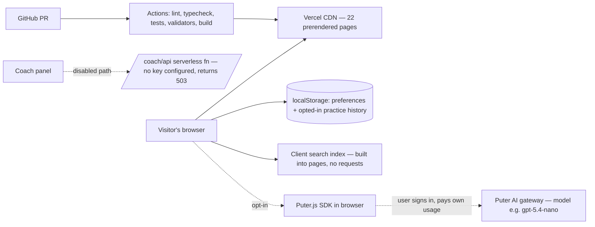

# Product Requirements Document — Cognitive Fitness & Human Development

Version 1.0 (hackathon submission package), 2026-10-04.
Status: documents the prototype as built on branch `arena/01a107a7-hackathon2`
(PR #3). This is a requirements/product document, not a legal or clinical
document. Detailed truth-sources are linked in
[Document map](#12-document-map-prd-links).

## 1. Product summary

**Cognitive Fitness & Human Development** is an evidence-informed learning
space where people explore how they think, learn, focus, sleep, manage
emotions, and build habits — through short guided paths, plain-language
concept explanations, small self-paced practice tools, and inspectable
research summaries. An optional in-browser AI guide is **user-pays**: each
visitor signs in with their own Puter.com account and consumes their own
free monthly allowance, so the product needs no API key, no server spend,
and no account system.

One-line pitch: *every page states why it exists — and the build fails if it
doesn't.*

## 2. Problem statement

1. **Overclaiming.** "Brain training" products routinely promise transfer
   effects the evidence does not support; serious meta-analyses (e.g.
   Simons et al., 2016) find little evidence that game-based training
   generalizes. Users cannot tell honest tools from hype.
2. **Fragmented learning.** Students, self-learners, and parents get
   concepts (textbooks), study technique (scattered blogs), and activities
   (apps) in separate places, with no guided path connecting
   *understand → experience → inspect → practice → apply → reflect*.
3. **Cognitive and visual overload.** Typical learning UIs bury the next
   action under decoration, duplicate navigation sets, ignore reading
   preferences, and provide no stated purpose per page.
4. **AI demos that exclude users.** Education demos usually hide an
   operator-billed API key behind a login or rate-limited demo, so real
   visitors either can't use them or cost the developer money per request.

## 3. Target users and jobs-to-be-done

| Audience | Job to be done | Primary routes |
|---|---|---|
| Students / exam learners | Structure revision around how memory and focus actually work | `/journeys`, `/explore`, `/train` |
| Self-learners / curious adults | Understand a claim about the mind well enough to check it | `/explore`, `/evidence`, `/lab`, `/coach` |
| Educators / parents | Find honest, bounded activities and their limits | `/develop`, `/evidence`, `/train` |
| Readers with access needs | Adjust text size, contrast, spacing, motion, guides — before first paint and per device | `/privacy` + global preferences panel |

Non-goals for audiences: children as a supported group (adult
self-declaration gates AI), clinical populations, or anyone seeking
diagnosis or treatment.

## 4. Solution overview

A static-first Next.js app with one enforced **structure-and-linkage
contract**: every route is registered in `content/routes-v1.json` with kind,
audience, purpose, primary action, anchor sections, and `leadsTo`. The page
shell renders breadcrumbs, a stated purpose, a boundary note, and a
registry-driven "where this leads" panel from that data; a validator runs in
CI so a page cannot ship unregistered. On top of the contract:

- **6 guided journeys (29 steps)** composing existing pages into
  short, honest paths — no accounts, no tracking, no completion records.
- **In-browser search** across concepts, paths, activities, atlas areas,
  claims, and sources — zero network requests, graceful fallback with zero
  JavaScript.
- **Reading preferences** (7 settings) applied pre-paint from
  `localStorage`, sync across tabs, tolerant of storage failure.
- **Local-only practice insight** (`/progress`): counts, ranges, cadence
  for sessions the visitor explicitly chose to save; never a pooled score.
- **Coach workspace** with three modes — *This device only* (default, no
  AI), *Puter.js user-pays guide* (opt-in), *operator OpenAI path*
  (disabled unless a server flag + key are set) — with per-message consent,
  rate limits, and fail-closed behavior.

## 5. Scope

### In scope (v1 prototype, this PR)

- 23 registered routes; whole-person development atlas (14 areas);
  8 untimed practice modes; 4 user-owned four-week schedules;
  evidence ledger with inspectable claims/sources.
- Journey content model + static pages; search; preferences; progress;
  Puter adapter (SDK single-load, auth gate, bounded one-turn requests,
  per-page quota 6/5 min, typed failures).
- Documentation + tests as quality gates; Vercel deployment plan.

### Explicitly out of scope (v1)

- Accounts, databases, public ranking, multiplayer verification, telemetry.
- Google Sign-In as an AI-provider switch (auth ≠ model authorization; no
  account store to hang it on — see `docs/AI-PUTER-REVIEW.md`).
- Under-18 flows, guardian consent, any clinical claim, validated
  curricula, WCAG conformance claims (manual audit is a release gate).
- Server-side AI key custody; unlimited-free-AI framing (Puter's
  "free" is a monthly allowance per user, then paid usage — the UI says so).

## 6. Requirements

Functional (all implemented on this branch unless marked ⬜); each row maps
to automated coverage where claimed.

| ID | Requirement | Verification |
|---|---|---|
| FR-1 | Every route declares kind/audience/purpose/primary action/anchors/leadsTo in the registry; unregistered or dangling routes fail validation | `node content/validate.mjs`, `tests/routes-registry.test.ts` |
| FR-2 | Page shell renders purpose, breadcrumbs, boundary, and "where this leads" from registry data; concept pages add evidence anchors | `tests/journeys/pages.test.tsx`, HTML smoke |
| FR-3 | ≥5 guided journeys, each 3–8 steps with purpose/action/takeaway/caution and resolvable links; every journey includes an evidence step | `content/journeys-v1.json` validation, `tests/journeys/content.test.ts` |
| FR-4 | Search works fully client-side, supports typo-grace, degrades to server-rendered list without JS | `tests/search/query.test.ts` |
| FR-5 | 7 reading preferences applied before first paint; Escape closes panel and restores focus; cross-tab sync; storage failure tolerated | `tests/accessibility-controls.test.tsx` |
| FR-6 | `/progress` shows only opted-in saved sessions, per activity, no combined score | `tests/progress/*` |
| FR-7 | Coach defaults to no-AI mode; Puter mode requires sign-in + per-message consent; consent invalidated by toggles (mode/adult declaration); OpenAI mode visible only if operator flag+key | `tests/coach/*` |
| FR-8 | Puter adapter: single SDK load, one bounded turn, reply-shape tolerant parsing, 6 req/5 min per page, typed failure kinds, no key custody | `tests/coach/puter-adapter.test.ts` |
| FR-9 | Kill switch `NEXT_PUBLIC_COACH_PUTER_ENABLED="false"` removes the Puter mode at runtime | covered by tests + config docs |
| FR-10 | Privacy page discloses every data path in-product (search, preferences, progress, journeys, Puter, challenge codes) | `tests/privacy-page.test.tsx` |

Non-functional:

- **NFR-1 Performance:** all routes prerendered static except the
  `/coach/api` function; no render-blocking third-party scripts (SDK loads
  on opt-in).
- **NFR-2 Privacy:** zero network requests on core flows; single
  `localStorage` key; no analytics/ad SDKs; security headers set.
- **NFR-3 Accessibility (design goal, not yet conformance-validated):**
  semantic landmarks, focus management, visible focus, pre-paint
  preferences; manual matrix remains a release gate (R-01…R-06).
- **NFR-4 Reliability:** every enhancement (search, panel, AI, saved
  progress) fails safe to plain reading/writing of the page.
- **NFR-5 Quality gates:** TypeScript strict; ESLint 0 errors; 37 test
  files / 187 tests; content validators; hosted CI (Actions + Vercel build)
  on every push and PR.
- **NFR-6 Honesty policy:** no score may be described as diagnosis, IQ, or
  proof of broad cognitive change; boundaries render on-page, enforced by
  shared coach rules and content review checklists.

## 7. Tools & technologies

| Layer | Choice | Why |
|---|---|---|
| Framework | Next.js 16.3.8 (App Router), static-first | prerendered pages, one dynamic route only for the optional AI proxy path |
| UI | React 19.3, CSS Modules + global layer, Tailwind 4 PostCSS pipeline | no component library weight; design tokens in CSS |
| Language | TypeScript 5.9.3 strict | registry and preference model are typed end-to-end |
| Content as data | `content/routes-v1.json`, `content/journeys-v1.json` + `content/validate.mjs` (Node ≥22) | structure/linkage is machine-checkable, not editorial convention |
| Testing | Vitest 5 + Testing Library + jsdom; ESLint 9 (`eslint-config-next`); Python `scripts/agent_flow.py` for orchestration | 187 unit/behavior tests; lint/type/build gates in CI |
| AI (optional, user-pays) | Puter.js `puter.ai.chat` in the browser; default model `gpt-5.4-nano`; per-user billing | no key in our infra; each visitor pays from their own allowance |
| AI (operator path) | Server route `/coach/api` to OpenAI, disabled (`COACH_AI_ENABLED` unset, no key) | kept as architecture demo of fail-closed provider gating |
| Hosting | Vercel (project `eng-ahmed-raza-ur-rehman/cognitive-fitness`, root `cognitive-fitness`, Node 22.x) | Git-integrated previews; check wired to PRs |
| Auth | None in-app; Puter sign-in is third-party account for AI billing only | privacy posture: no accounts means no account data |

## 8. System diagram (high level)

Browser → provider only for the opt-in guide; the app server holds no
credential. Content registry + validators gate every build.

## 9. Finance

Operating model chosen to make the hackathon build **$0/month** while honest
about what would change at scale:

| Item | Cost today | Note |
|---|---|---|
| Development toolchain | $0 | open-source; local dev + sandbox |
| Hosting (Vercel Hobby) | $0 | Hobby tier forbids commercial use; if the product commercializes: Pro is $20/developer/month (verify current pricing before launch) |
| Domain | $0 on `*.vercel.app` | optional custom domain ≈ $10–20/yr (registrar/managed) |
| AI — Puter user-pays mode | $0 to operator | each user gets a free monthly allowance, then pays per usage from their own account; popup sign-in; we hold no keys |
| AI — operator OpenAI path | disabled, $0 | if enabled, operator's API account pays per token; request is hard-bounded (~2k in / ≤900 chars out per message) |
| Analytics / ads / email | $0 — deliberately none | product privacy posture; no data pipeline to pay for |
| CI | $0 | Actions minutes within free tier at this scale |

Risks: Vercel Hobby + a public "AI product" is the one combination that can
force a paid upgrade — flagged in `docs/RELEASE-CHECKLIST.md` for the owner
to confirm plan/commercial eligibility before any launch.

## 10. Success metrics (post-launch proposal)

No telemetry exists by design, so metrics must stay measurable without it:
validator/lint/test counts in CI (currently: 23 pages, 6 journeys/29 steps,
187 tests, 0 lint errors), deploy success, and opt-in feedback channels. If
the product later adds measurement, it is a privacy-review gate, not a
feature flag.

## 11. Risks & open gates (from the release checklist)

Manual accessibility/device matrix (screen reader, keyboard-only, zoom,
contrast, touch, two devices) not run; legal/privacy review pending
(`/privacy` is a prototype disclosure, not a policy); independent
security/evidence review pending; CSP/SRI decision for the third-party Puter
script open (R-04); adversarial prompting of the AI guide not run (R-05);
preference matrix coverage of all 7 settings incomplete (R-06); `main`
branch protection not yet confirmed to require the checks. None of these are
claimed as passed.

## 12. Document map (PRD links)

- Requirements detail & evidence: [`REQUIREMENTS.md`](REQUIREMENTS.md) ·
  [`RELEASE-CHECKLIST.md`](RELEASE-CHECKLIST.md) ·
  [`EVIDENCE-LEDGER.md`](EVIDENCE-LEDGER.md)
- Tools & architecture: [`ARCHITECTURE.md`](ARCHITECTURE.md) ·
  [`TECH-DECISIONS.md`](TECH-DECISIONS.md) · [`../README.md`](../README.md)
- AI & cost model: [`AI-PUTER-REVIEW.md`](AI-PUTER-REVIEW.md) ·
  [`AI-VERIFICATION.md`](AI-VERIFICATION.md) ·
  [Puter user-pays model](https://docs.puter.com/user-pays-model/)
- Product & scope: [`PRODUCT.md`](PRODUCT.md) ·
  [`EXPERIENCE-SYSTEM.md`](EXPERIENCE-SYSTEM.md) ·
  [`ROADMAP.md`](ROADMAP.md)
- Accessibility & privacy: [`ACCESSIBILITY-PLAN.md`](ACCESSIBILITY-PLAN.md) ·
  [`PRIVACY.md`](PRIVACY.md) · [`THREAT-MODEL.md`](THREAT-MODEL.md)
- Submission pack: [`presentation/SLIDES.md`](presentation/SLIDES.md) ·
  [`presentation/cognitive-fitness-slides.pptx`](presentation/cognitive-fitness-slides.pptx) ·
  [`presentation/DEMO-VIDEO-GUIDE.md`](presentation/DEMO-VIDEO-GUIDE.md) ·
  [`presentation/TRANSCRIPT-EN.md`](presentation/TRANSCRIPT-EN.md) ·
  [`presentation/TRANSCRIPT-UR.md`](presentation/TRANSCRIPT-UR.md)
